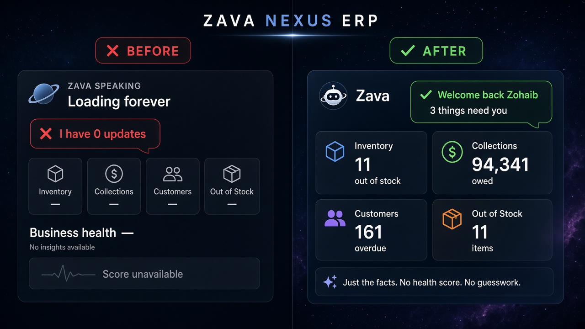

# Zava Nexus — alert parity (before / after)

| | Before | After |
|---|---|---|
| Welcome | “I have 0 updates” while alert bar shows unpaid / overdue / OOS | Same numbers as top alert bar: “3 things need you: … overdue, $ owed, N out of stock” |
| Data | Re-fetched invoices/products inside Nexus | Reuses App `aiCtx` via `ErpShellContext` + shared `computeAlertCounts` |
| Tiles | Bare “—” / Payroll & AI always shown | One plain fact, or Retry on failure, or **hidden** (Payroll, AI & Team, Sales today) |
| Health | Fake Beta score / “—” | Hidden until defined |
| Voice | Welcome before numbers; “SPEAKING · Loading…” stuck | Welcome after shell ready; title “Zava · speaking” only while speaking; speak timeout → idle |
